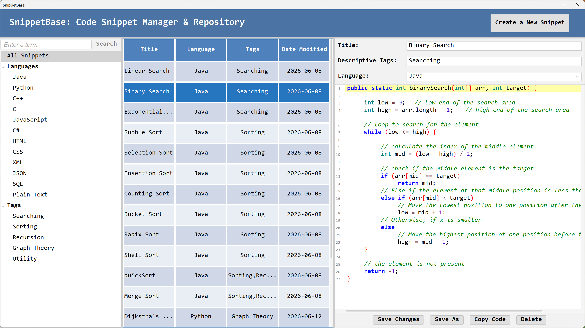

# SnippetBase


**SnippetBase** is a local Java Swing desktop application for storing, organizing, searching, editing, and exporting reusable code snippets. Built with the **Model-View-Controller (MVC)** architecture, it combines a categorized tree sidebar, tabular snippet browser, and syntax-highlighted code editor with automatic local persistence.

- **Author:** Qianyi Ma
- **Course:** ICS4U1-02 (Final Summative Project)
- **Date:** June 12, 2026

---

## Features

- **Snippet Management (CRUD):** Create, view, edit, and delete snippets with title, descriptive tags, programming language, code content, and automatic date modified tracking (`LocalDate`).
- **Input Validation & Safeguards:** Prevents empty titles or tags, blocks duplicate snippet titles (case-insensitive), and asks for confirmation before deleting a snippet.
- **Tree Categorization:** Browse snippets in the left sidebar via `All Snippets`, `Languages`, and dynamically updated `Tags` categories (`JTree`).
- **Keyword Search:** Filter snippets by title using a case-insensitive keyword search bar.
- **Tabular Snippet Browser:** View matching snippets in a styled `JTable` showing **Title**, **Language**, **Tags**, and **Date Modified**.
- **Integrated Code Editor:** Powered by `RSyntaxTextArea` and `RTextScrollPane`, featuring:
  - Dynamic syntax highlighting matched to the selected language
  - Line numbers and code folding indicators
  - Auto-indentation and animated bracket matching
- **Clipboard & File Export:**
  - **Copy Code:** Copies the current snippet code directly to the system clipboard.
  - **Save As:** Exports the current snippet to an external file via `JFileChooser` with the appropriate file extension automatically appended.
- **Automatic Local Persistence:** Loads all tags and snippets from `file/snippetBaseData.txt` on startup (pre-loaded with 17 sample snippets across 5 tags) and saves changes automatically when closing the window.
- **Modern UI Theme:** Styled with `FlatLightLaf` (`flatlaf-3.7.1.jar`).

---

## Supported Languages

Defined in `src/model/Language.java`:

| Language | File Extension | Language | File Extension |
| --- | --- | --- | --- |
| Java | `.java` | HTML | `.html` |
| Python | `.py` | CSS | `.css` |
| C++ | `.cpp` | XML | `.xml` |
| C | `.c` | JSON | `.json` |
| JavaScript | `.js` | SQL | `.sql` |
| C# | `.cs` | Plain Text | `.txt` |

---

## Screenshots



---

## Architecture & Project Structure

SnippetBase follows the **MVC** pattern across four packages:

- **`application`**
  - `SnippetBaseApplication.java` — Initializes `FlatLightLaf`, loads repository data via `FileController`, and launches `SnippetBaseController`.
- **`model`**
  - `Snippet.java` — Data model holding `id`, `title`, `tags`, `language`, `code`, and `date`.
  - `Repository.java` — Manages the snippet and tag lists, ID tracking, and title keyword search (`searchSnippet`).
  - `Language.java` — Enum mapping each supported language to its display name, `RSyntaxTextArea` syntax constant, and file extension.
- **`view`**
  - `MainFrame.java` — Main `1920x1080` application window assembling the header, navigation, listing, and detail panels.
  - `NavigationPanel.java` — Left panel containing the search bar and `JTree` category filter (`All Snippets`, `Languages`, `Tags`).
  - `ListingPanel.java` — Center panel containing the custom-rendered `JTable` of filtered snippets.
  - `DetailPanel.java` — Right panel with title/tag inputs, language dropdown, `RSyntaxTextArea` editor, and action buttons (`Save Changes`, `Save As`, `Copy Code`, `Delete`).
- **`controller`**
  - `SnippetBaseController.java` — Coordinates UI events (`ActionListener`, `TreeSelectionListener`, `ListSelectionListener`, `WindowListener`) between models and views.
  - `FileController.java` — Handles reading/writing `file/snippetBaseData.txt` and exporting snippets to external source files.

```text
FSP - SnippetBase/
├── docs/
│   └── screenshots/
│       └── workspace.png            # Application screenshot
├── file/
│   └── snippetBaseData.txt          # Local snippet & tag repository data
├── lib/
│   ├── flatlaf-3.7.1.jar            # FlatLaf Look & Feel library
│   └── rsyntaxtextarea-3.6.2.jar    # Syntax-highlighting editor component
├── src/
│   ├── application/
│   │   └── SnippetBaseApplication.java
│   ├── controller/
│   │   ├── FileController.java
│   │   └── SnippetBaseController.java
│   ├── model/
│   │   ├── Language.java
│   │   ├── Repository.java
│   │   └── Snippet.java
│   └── view/
│       ├── DetailPanel.java
│       ├── ListingPanel.java
│       ├── MainFrame.java
│       └── NavigationPanel.java
├── bin/                             # Compiled .class files (Eclipse output)
├── .classpath
├── .project
└── README.md
```

---

## Getting Started

### Prerequisites

- **Java Development Kit (JDK) 21** or newer (`JavaSE-21` configured in `.classpath`)
- **Eclipse IDE** (optional, project files `.project` and `.classpath` are included)

### Clone the Repository

```bash
git clone https://github.com/doduoduoniaodo/SnippetBase.git
cd SnippetBase
```

### Option 1: Run in Eclipse

1. Open Eclipse and choose **File > Import... > General > Existing Projects into Workspace**.
2. Select the cloned `SnippetBase` root directory and click **Finish**.
3. Confirm `lib/flatlaf-3.7.1.jar` and `lib/rsyntaxtextarea-3.6.2.jar` appear under **Referenced Libraries** in the Build Path.
4. Run `src/application/SnippetBaseApplication.java` as a **Java Application**.

### Option 2: Compile & Run from the Command Line

Run commands from the project root directory so that the relative path `file/snippetBaseData.txt` resolves properly.

**Windows (PowerShell / CMD):**

```powershell
javac -cp "lib/*" -d bin src/application/*.java src/controller/*.java src/model/*.java src/view/*.java
java -cp "bin;lib/*" application.SnippetBaseApplication
```

**macOS / Linux:**

```bash
javac -cp "lib/*" -d bin src/application/*.java src/controller/*.java src/model/*.java src/view/*.java
java -cp "bin:lib/*" application.SnippetBaseApplication
```

---

## Usage & Notes

1. Click **Create a New Snippet** in the top header to clear the editor and start a new snippet.
2. Enter a **Title**, comma-separated **Descriptive Tags** (e.g., `Searching,Utility`), select a **Language**, and write or paste your code.
3. Click **Save Changes** to add or update the snippet in the table and navigation tree.
4. Select any category under **Languages** or **Tags** in the left tree, or use the **Search** bar to filter snippets by title.
5. Click any row in the center table to load it into the editor, then use **Copy Code**, **Save As**, or **Delete**.

### Important Notes

- **Do not manually edit `file/snippetBaseData.txt`:** The file parser relies on exact counts, line ordering, and `[SPLIT]` / `[END]` markers. Modifying the format manually may cause snippets to fail to load on startup.
- **Keep the `lib/` directory intact:** Both `flatlaf-3.7.1.jar` and `rsyntaxtextarea-3.6.2.jar` are required at compile time and runtime.
- **Display Resolution:** `MainFrame` is configured with a fixed `1920x1080` non-resizable window (`setResizable(false)`).

---

## Acknowledgements

- [FlatLaf](https://www.formdev.com/flatlaf/) — Modern flat Look and Feel for Java Swing
- [RSyntaxTextArea](https://github.com/bobbylight/RSyntaxTextArea) — Syntax-highlighting text component for Java Swing
